## About
Lamina is a FFXIV dalamud plugin that takes your appearance automation to the next level by introducing the concept of virtual designs. Layer multiple designs by rulesets and apply a final virtual look with only one redraw. It's better to read the example to get it instead of explaining.

## Example
You are RP'ing as multiple characters, and each of them has a special look in different possible situations, and not only that, they also have special titles, buffs or debuffs, and even specific mods activated at a time (VFX, SFX, Animation, etc...). You want to switch between them in one click and also see them swap between all these modes super quick.
If that sounds like something you want, then Lamina is for you.

## A tour in pictures
The screenshots below walk through one setup from the top down: a profile, the groups and passes inside it, the layers inside a pass, and what the character looks like at the end.

### Lamina works inside its own Penumbra collection
This is the most important thing to know. Lamina never touches your main collection. It writes mod states only into a collection you name (the default is **Lamina**), as temporary settings it can remove again in one call. You create that collection in Penumbra, assign your character to it, and from then on Lamina switches mods on and off inside it.

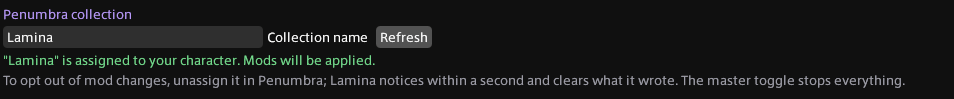

In the Settings tab: (1) the collection name Lamina looks for, (2) Refresh after you create or assign it in Penumbra, (3) the status line. Green means the collection exists and your character is assigned to it. If it is missing or not assigned, the same line tells you what to do. Lamina never assigns or unassigns the collection itself; to opt out of mod changes, unassign it in Penumbra and Lamina clears what it wrote within a second. Glamourer, Honorific, Moodles, Customize+ and Simple Heels still apply without the collection; only mods need it.

### One switch, a whole character
Lamina off is your plain Glamourer and Penumbra state. Lamina on is whatever the active profile resolves to: outfit, hair, hair colour, body mods, titles, tattoos. Flipping the switch is one redraw either way.

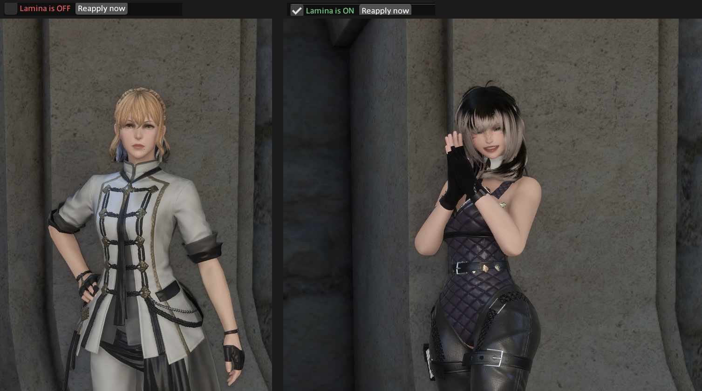

Off is a full cleanup, not a pause: Lamina's mod settings, the Glamourer state, the title, moodles, the temporary Customize+ profile and the Simple Heels offset it set are all removed.

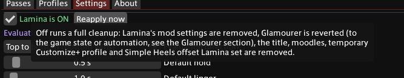

The switch and a Reapply action can also sit in the Dalamud server info bar: Settings → Server info bar has one checkbox per entry (both off by default). Left click acts, right click opens Lamina; where the entries sit in the bar is set in Dalamud's own Server Info Bar settings.

### Profiles: one per character
A profile is a complete Lamina setup. Keep one per character (or per mood) and tick the one you want; enabling a profile disables the others for the same target. Profiles can be exported and imported from the clipboard, so you can share a whole character with a friend.

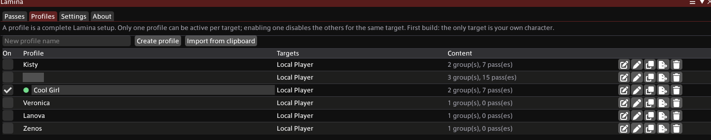

(1) Create a profile or import one from the clipboard. (2) The On column: tick a profile to make it the active one, the dot marks which one is live. (3) Per-profile actions: edit, rename, duplicate, export to clipboard, delete.

### Targets: your character, another player, or an NPC
By default a profile applies to your own character. The crosshair button in the Targets column opens the target picker, where a profile can also follow another player (by name and home world) or a humanoid NPC rendered near you. Only characters that can actually take on a look are offered: players and NPCs with a human model. Minions, mounts, monsters and objects never appear in the list.

Each target receives only what applies to it. Another player gets Glamourer, Penumbra mods, Honorific, Moodles, Customize+ and Simple Heels, but no decals, since those are baked onto your own body. An NPC gets Glamourer, Customize+ and mods. Whatever a target cannot take is listed next to it and in `/lam targets`, never reported as a failure.

Mods for another character are written into Lamina's own collection (the one from Settings) by default, so a Penumbra Adjust layer in that profile enables its mods there just like one of yours would. To see them on the character, assign it to that collection in Penumbra under Individual Assignments; Lamina never assigns collections itself, and until you do the settings sit in the collection without showing on them. You can also name a different collection on the target. Profiles can share a collection because each one only removes the mods it wrote; if two profiles set the same mod differently, the one applied last wins. In the pass editor, layers that none of a profile's targets can take (an Honorific layer in an NPC-only profile, say) are greyed out and cannot be added.

The profile applies while the character is rendered and re-asserts itself when they come back into view. Switch the profile off while they are away and Lamina still takes back what it can by identity (the Glamourer state and the Customize+ profile); the rest is undone the next time the character appears. Conditions are always evaluated against your own state; the target just receives the result.

### Pass groups and passes
Inside a profile, looks are organized into **pass groups** and **passes**. Groups are checked top to bottom and the first group whose conditions match wins. Inside a group every matching pass contributes its layers, and lower passes override higher ones. A group marked **Final Pass** sits in its own section below and is layered on top of whichever group won, so "take the helmet off while sitting" works no matter which look is active.

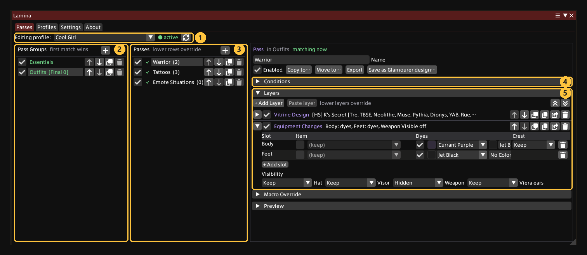

(1) The profile you are editing, with a live indicator. (2) Pass groups, checked top to bottom; the first group whose conditions match wins. (3) The passes in the selected group; lower rows override higher ones, and a green tick marks a pass that matches right now. (4) The selected pass's conditions. (5) Its layers.

A group can carry its own conditions, so a whole set of passes only exists while, say, you are in a housing district or on a healer job.

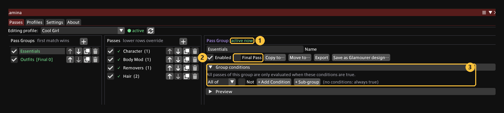

(1) The group is active now. (2) Final Pass: layer this group on top of the winning group instead of competing with it. (3) Group conditions, which gate every pass inside the group.

### Conditions
Each pass (and each group) has a condition tree. Conditions combine with **All of** or **Any of**, can be negated with **Not**, and nest into sub-groups for anything more involved.

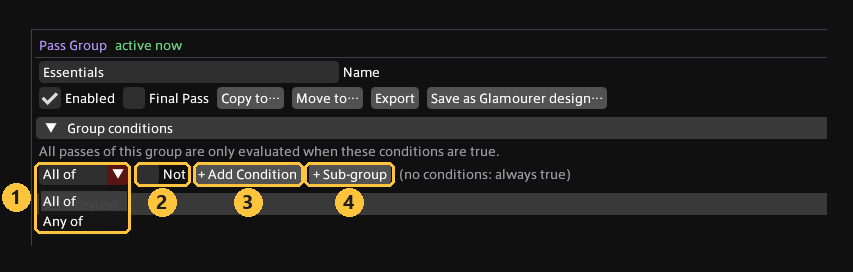

(1) All of / Any of. (2) Not inverts the whole block. (3) Add a condition. (4) Add a nested sub-group with its own All of / Any of.

Condition types cover time, calendar, weather, biome, location, duty, housing, social state, character, job, online status, status effects, movement, body state, emote or pose, and activity.

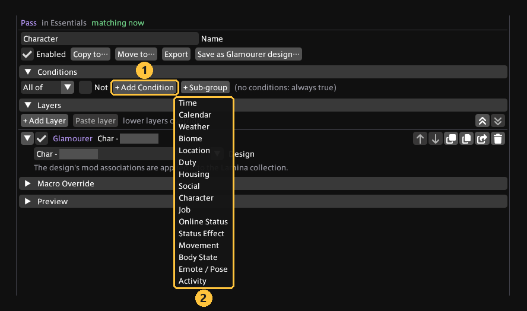

(1) Add Condition opens (2) the list of condition types.

Each type has its own editor. The Job condition, for example, matches on jobs, roles, disciplines or gearsets, a level range and whether the weapon is drawn, with hold and linger timers so a quick weapon flick does not flicker your outfit.

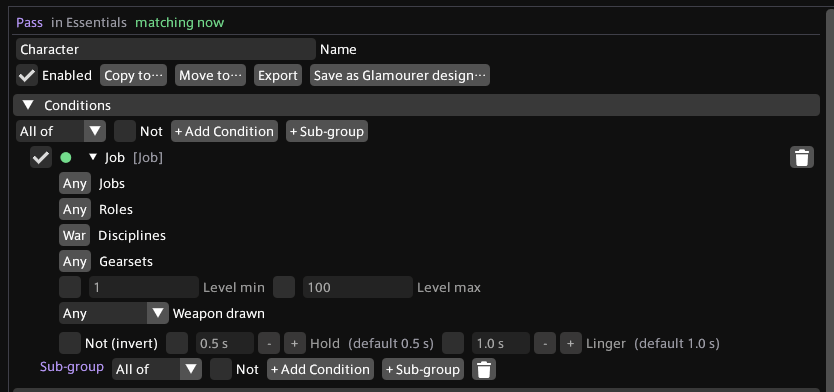

(1) Match on jobs, roles, disciplines or gearsets. (2) Level range. (3) Weapon drawn or sheathed. (4) Not inverts the condition; Hold and Linger delay the switch on and off.

### Layers
A pass is a stack of layers, and lower layers override the ones above them. Layer types: Glamourer design, Equipment Changes, Equipment Cleanse, Dye Cleanse, Appearance Changes, Penumbra Adjust, Vitrine Design, Honorific, Moodles, Customize+, Simple Heels, Decal and Decal Cleanse.

**Random Layers** is a second section under the layer stack. Only one of the layers in it is used, picked with equal chance each time the pass starts contributing, and it merges after the stack above. The pick stays until the pass stops contributing, so walking around or a weather change does not reshuffle it. Put one idle mod per layer there and a different idle plays each time the pass kicks in; "Roll again" in the section or `/lam reroll` picks anew.

**Penumbra Adjust** sets the state, priority and option groups of individual mods. Every part has an "applies" checkbox, so a pass can flip one option group of a mod that an earlier pass enabled and inherit the rest.

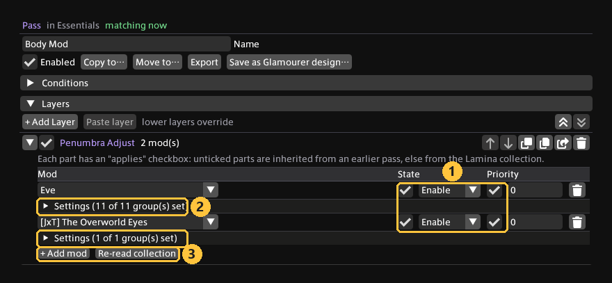

(1) The "applies" checkboxes next to State and Priority: only ticked parts are written, the rest is inherited. (2) Each mod's option groups, with the same per-group checkboxes. (3) Add a mod, or re-read the Lamina collection to pick up what Penumbra has.

**Appearance Changes** edits the Glamourer customization fields directly, no saved design needed. Only ticked fields apply; everything else passes through from the layers above. Here a Vitrine hair design is stacked with a hair colour and highlights colour change.

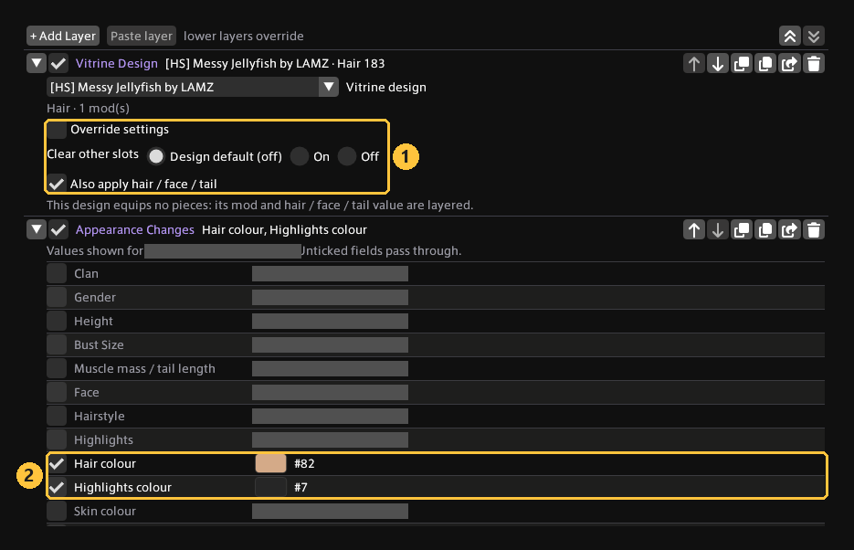

(1) The Vitrine layer's switches: override the mod's settings, clear other slots, and apply the design's hair / face / tail value. (2) The two Appearance Changes fields that are ticked and therefore applied; the unticked rows show the current value and pass through.

**Equipment Changes** does the same for gear: an item per slot, dyes, crest, and hat / visor / weapon / Viera ears visibility. Here it recolours the body and feet of the outfit layered above it.

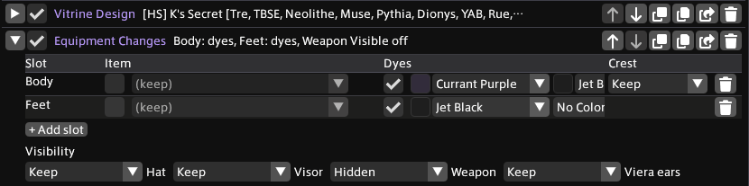

(1) Item per slot; "(keep)" leaves the item from the layers above. (2) The dye "applies" checkboxes: ticked, so these dyes are written over the outfit. (3) Hat, visor, weapon and Viera ears visibility.

### Outfits from Vitrine
With the separate [Vitrine](https://github.com/AHAKuo/FFXIVVitrine) plugin installed, any mod in your Penumbra collection becomes a design you can drop into a pass. Vitrine shows the mod's own preview photo and the items it affects.

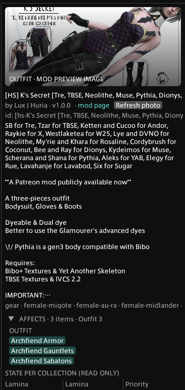

The **Vitrine Design** layer carries the mod's settings and the pieces the design equips. **Override slots** lets one pass take the body from one design and the boots from another, and **Clear other slots** empties every slot the design does not fill so an earlier outfit does not bleed through.

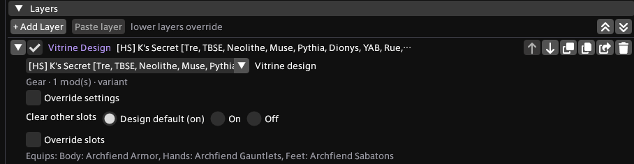

(1) Override the mod's option settings for this pass. (2) Clear other slots: design default, forced on, or forced off. (3) Override slots to take only some of the pieces. (4) The pieces this design equips.

### Tattoos, freckles and beauty marks (Decal layer)
The **Decal** layer puts a PNG or JPG on your character's skin. It is experimental: it needs a click on true skin, mirrored-UV bodies show it on both sides, and some body mods replace the skin texture in ways the bake cannot follow.

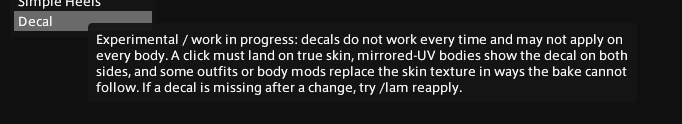

Pick an image, press **Place**, then click the spot on your character in the game world. Lamina names the nearest bone and bakes the decal into the body or face texture.

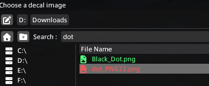

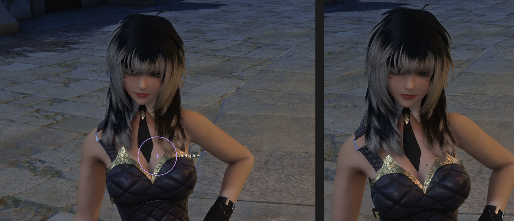

Each decal has a size, rotation and opacity.

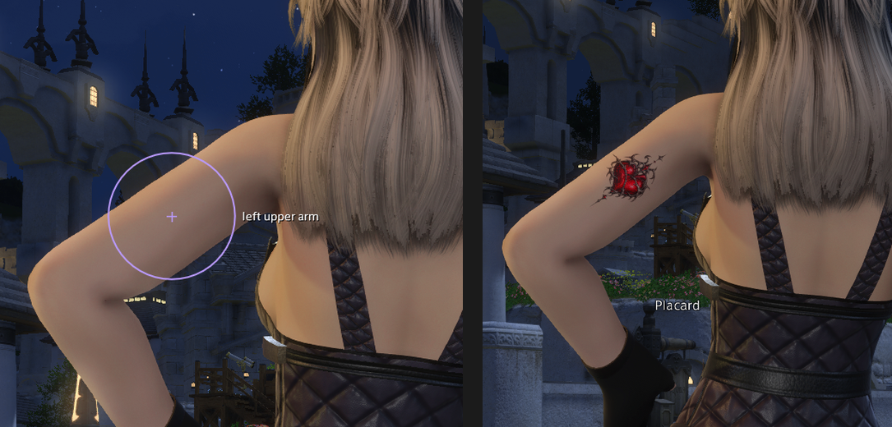

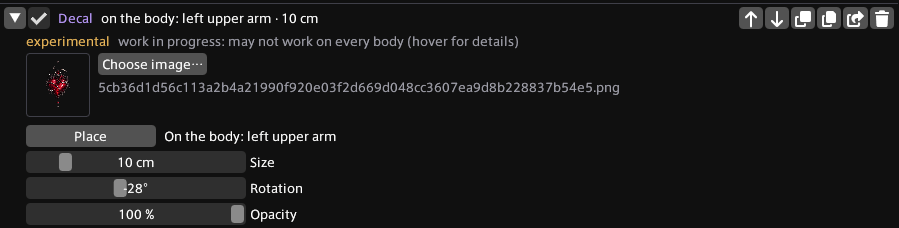

The decal is part of the skin, so it holds up from any angle and in any light.

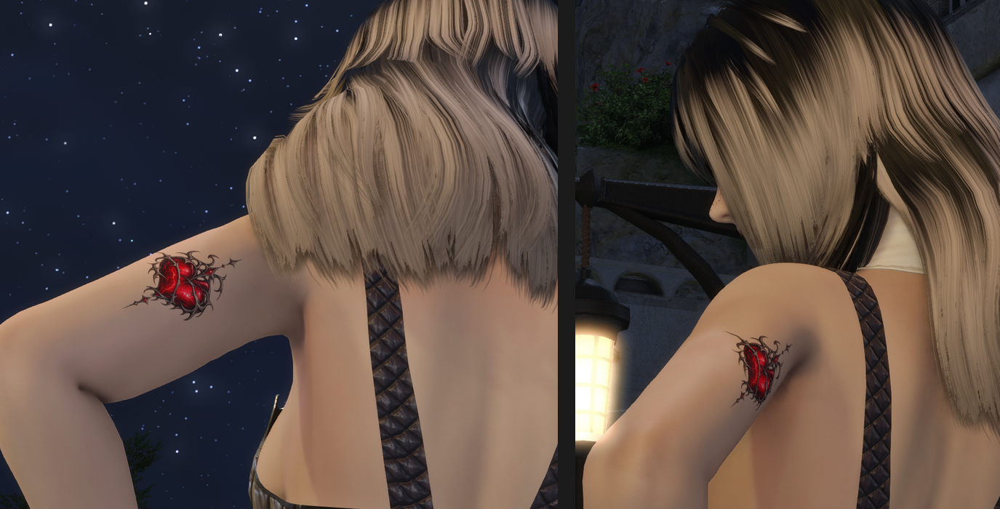

Decals stack. This pass carries three: a beauty mark on the chest, a tattoo on the arm and freckles on the face.

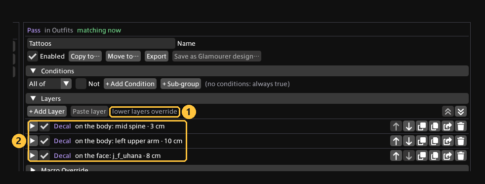

(1) Lower layers override. (2) Three Decal layers stacked in one pass, each with its own spot and size.

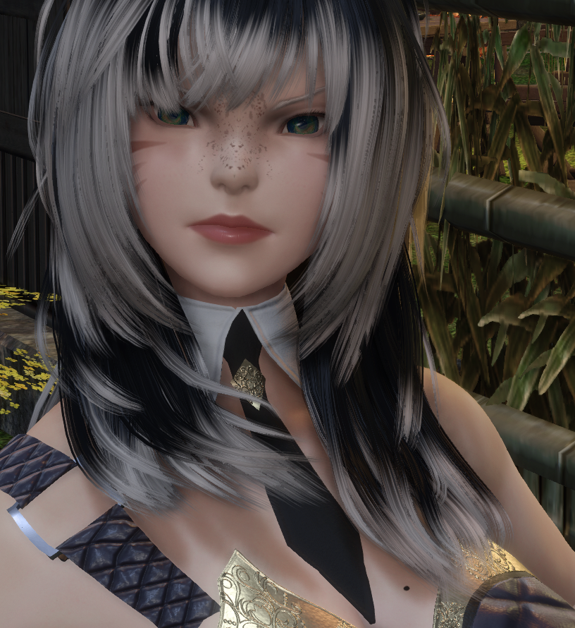

## Installation
Lamina is one of ahadev's plugins and installs through Dalamud's plugin installer from a custom repository.

1. In game, type `/xlsettings` to open the Dalamud settings and go to the **Experimental** tab.
2. Under **Custom Plugin Repositories**, paste this URL into the empty field, click the **+** button, then **Save and Close**:
   ```
   https://raw.githubusercontent.com/AHAKuo/ahadevtools/main/pluginmaster.json
   ```
3. Type `/xlplugins` to open the plugin installer, search for **Lamina** and click **Install**.
4. Make sure Glamourer and Penumbra are installed and enabled.
5. In Penumbra, create a new collection named **Lamina** (recommended; the name can be changed in Lamina's Settings tab). Let it inherit from your main collection so your usual mods stay on, then assign your character to it (**Collections → Individual Assignments**, or **Your Character**). Lamina only writes mod states into this collection and never touches your main one.
6. Type `/lam` to open Lamina, go to **Settings** and check the Penumbra collection line reads green. Press **Refresh** if you just created the collection.

Updates arrive through the same installer like any other plugin. The repository also lists ahadev's other plugins (Vitrine among them), so you only add it once.

## Requires
- Glamourer.
- Penumbra.

## Supports
- Honorific.
- Moodles.
- Customize+ (a saved profile as a layer, applied as a temporary profile).
- Simple Heels (a height offset as a layer, registered over IPC).

## Features
- Penumbra mods enable/disable state handling based on virtual designs (auto-resolved).
- Layering of Glamourer designs.
- Native layers without a Glamourer design: **Equipment Changes** (item per slot incl. "Nothing", facewear, dyes, crest, hat / visor / weapon / viera ears visibility) and **Appearance Changes** (hair, colours, face, shapes, height, wetness, advanced RGB parameters), with pickers that only show values valid for your clan and gender.
- Penumbra Adjust with per-setting "applies" checkboxes: a pass can change one option group of a mod an earlier pass enabled; everything unticked is inherited from the earlier pass or the Lamina collection.
- Application of Honorific titles.
- Application of Moodles states.
- Customize+ layer: pick one of your saved Customize+ profiles; Lamina applies its bone edits as a temporary profile while the pass matches and removes it again afterwards. Bones of several Customize+ layers merge, so a later pass can override single bones.
- Simple Heels layer: a height offset, either added to the offset Simple Heels already gives you (default, follows your footwear) or replacing it. Registered over IPC while the pass matches.
  Note: Customize+ does not report temporary profiles and Simple Heels does not report IPC registrations to Mare-style sync plugins, so other players do not see these two layers yet.
- Vitrine integration (optional): use designs from the separate Vitrine plugin as layers, with a per-layer slot mask to combine pieces of several designs and a "clear other slots" switch.
- Equipment Cleanse layer: empties every gear slot (weapons stay) so the outfit layers after it start from a bare body.
- Dye Cleanse layer: clears dye 1 and dye 2 in every slot, weapons included, without touching the items.
- Random Layers section per pass: one of its layers is picked with equal chance each time the pass starts contributing (idle mod roulette), kept until the pass stops; `/lam reroll` or the section's button rolls anew.
- Server info bar (DTR) entries, each optional: **Lamina: Reapply** (click = `/lam reapply`, tooltip shows the active profile and last apply time) and **Lamina: On / Off** (click flips the master toggle, muted when off). Right click on either opens Lamina.
- Decal layer: a PNG or JPG placed on your character's skin by clicking it in the game world, with size, rotation and opacity; it is baked into the body or face texture and shown through a temporary Penumbra mod in the Lamina collection.
- Decal Cleanse layer: removes every decal painted before it (earlier layers and passes); Decal layers after it still apply. Decals only accumulate without it.

## Virtual Designs
A Virtual Design is a design created by combining multiple different rulesets and combining the resulting Glamourer, Honorific, Moodles, Customize+, Simple Heels and Penumbra statuses into one final design. This design is applied in one pass with efficient handling to prevent slow flickers or heavy condition swapping. The character is drawn ONCE after the virtual design is determined.

## Works with Vitrine (separate plugin, optional)
Vitrine is ahadev's standalone mod browser: it organizes your Penumbra mods by what they change, shows their display photos, lets you try a mod on your character (mod + a full set of its affected items) and turns each mod into a design with your baseline settings. Lamina does not need it to run. When Vitrine is installed, Lamina finds it automatically and its designs become a layer type ("Vitrine Design") you can use in any pass: the layer carries the design's mod settings (overridable per pass) and the pieces the design equips (its affected slots). "Override slots" narrows those pieces per layer, so one pass can take the body from one Vitrine design and the boots from another; the mods themselves are always applied in full. "Clear other slots" (the design's own flag, overridable per layer) empties every gear slot the layer does not fill so an earlier outfit does not bleed through. Needs Vitrine 0.3 or newer for pieces, 0.4 for the clear flag. Repository: https://github.com/AHAKuo/FFXIVVitrine

## Third-party code
- `XivLiveMesh/` is vendored from [Proteus](https://github.com/solona-m/proteus) by Solona, licensed under the AGPL-3.0-or-later (the same license as Lamina; see `XivLiveMesh/LICENSE` and `XivLiveMesh/NOTICE.md`). It poses a worn model's vertices onto the live character on the CPU (racial bone deformer, then skinning), captures the game camera and picks a point under the mouse. Lamina's decal placement is built on it. Its `PbdFile.cs` was ported in Proteus from [Meddle](https://github.com/PassiveModding/Meddle) (AGPL-3.0). It references FFXIVClientStructs (MIT) through Dalamud and does not redistribute it.
